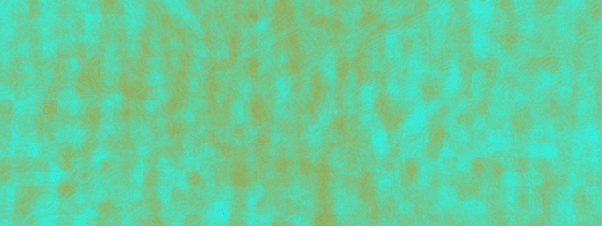
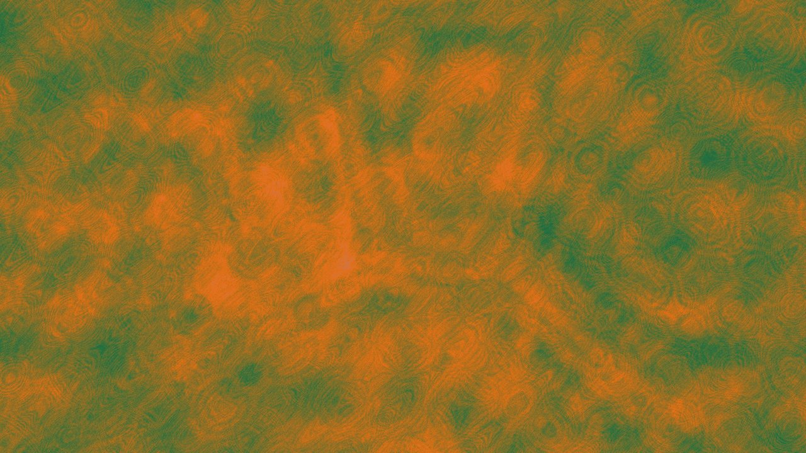
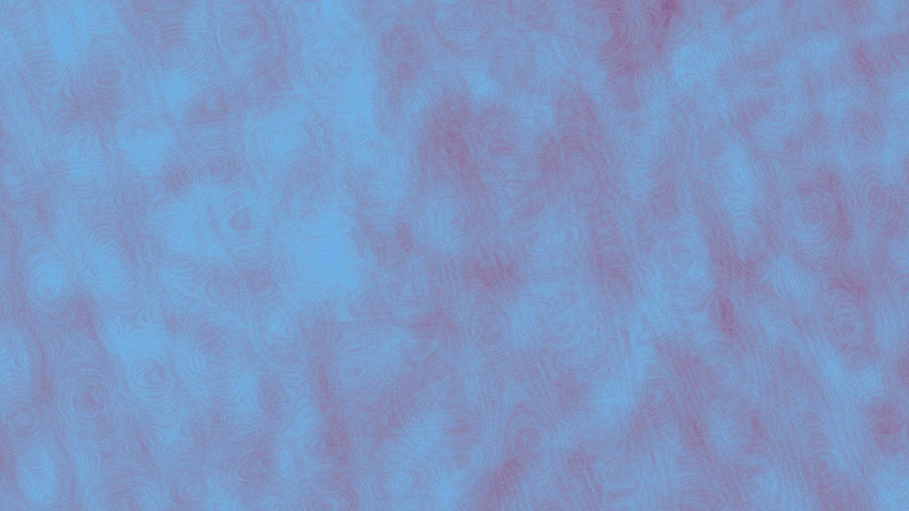
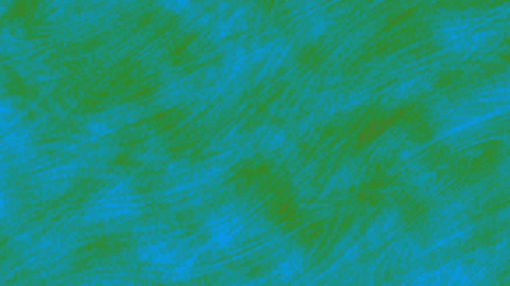
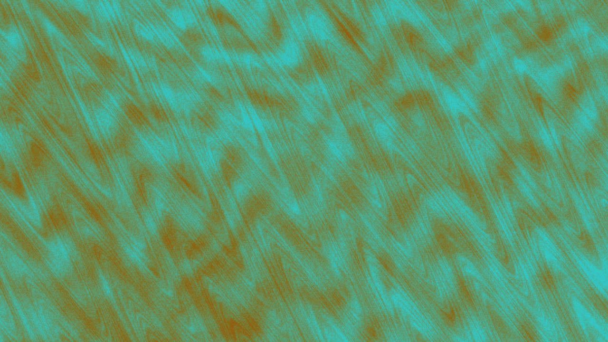
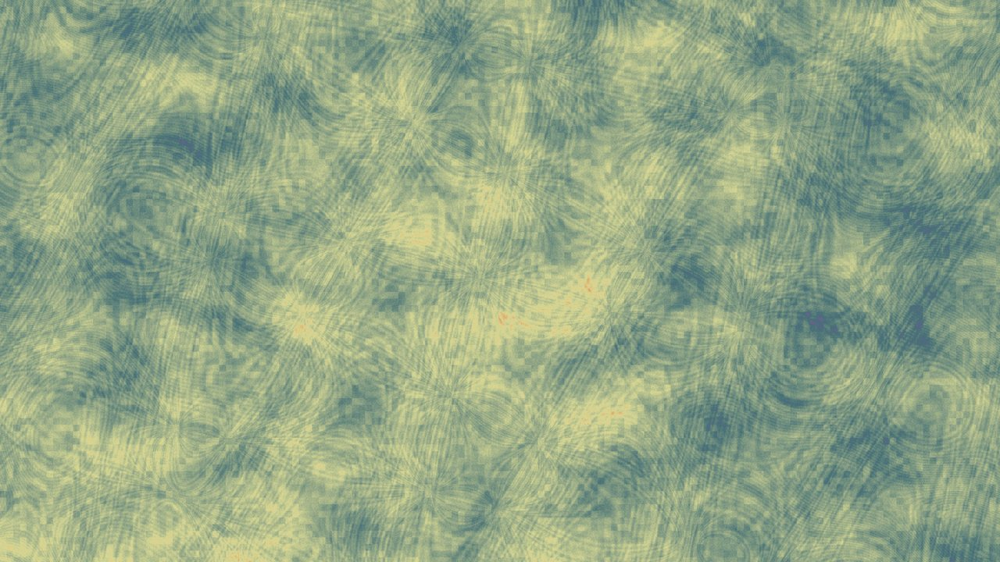
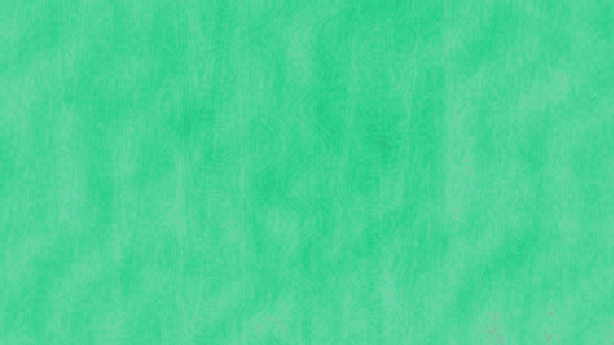

# Random Art Generator

<p align="center">
  
</p>

<p align="center"><em>Project artwork · Seed 20261027 · 2400 × 900</em></p>

A cross-platform C++17 application for creating abstract images at native display resolution or at dimensions you choose. The desktop interface and command-line renderer share the same pixel-level generation pipeline, parallel CPU rendering, and reproducible seeded output.

The renderer combines ten structural fields and two restrained noise fields in one image. It does not choose a single style. It does not contain a library of finished pictures. Each result is calculated pixel by pixel from a new set of randomized parameters.

## Gallery

Each sample uses the complete renderer: ten structural fields blended with two restrained noise fields. Select a preview to open its full-resolution 8K UHD master. The listed seed reproduces the composition with the command-line program.

| Seed 1701 | Seed 2718 |
|---|---|
| [](assets/gallery/sample-01.jpg)<br>7680 × 4320 · [Open 8K original](assets/gallery/sample-01.jpg) | [](assets/gallery/sample-02.jpg)<br>7680 × 4320 · [Open 8K original](assets/gallery/sample-02.jpg) |
| [](assets/gallery/sample-03.jpg)<br>7680 × 4320 · [Open 8K original](assets/gallery/sample-03.jpg) | [](assets/gallery/sample-04.jpg)<br>7680 × 4320 · [Open 8K original](assets/gallery/sample-04.jpg) |
| [](assets/gallery/sample-05.jpg)<br>7680 × 4320 · [Open 8K original](assets/gallery/sample-05.jpg) | [](assets/gallery/sample-06.jpg)<br>7680 × 4320 · [Open 8K original](assets/gallery/sample-06.jpg) |

The linked masters are 7680 × 4320 progressive JPEGs. Lightweight 1280 × 720 previews keep the landing page responsive while preserving the full-resolution artwork for inspection or download. The application can render at the detected display resolution, and the CLI accepts custom dimensions up to the configured 300-million-pixel safety limit.

## What it does

- Opens a desktop GUI, maximized on Windows, with native-resolution defaults.
- Generates a new image each time you press **Generate art** or the spacebar.
- Shows the seed used for each generation.
- Previews the image and saves PNG or JPEG.
- Uses CPU worker threads to render rows in parallel.
- Provides a CLI for automation, custom sizes, and repeatable output.

Windows uses the Win32 API and does not need a separate GUI framework. macOS and Linux use Qt 6 Widgets and Qt Concurrent. PNG output is available without an image library; JPEG support in the CLI depends on libjpeg, while the GUI uses its platform image writer.

## Quick start

### Windows

Install CMake 3.16 or newer and Visual Studio Build Tools with the **Desktop development with C++** workload. Then run:

```powershell
.\quickstart.bat
```

The launcher searches common CMake installation paths, builds the GUI, and opens it. It does not install missing dependencies.

### macOS and Linux

Install CMake, a C++17 compiler, and Qt 6 with the Widgets and Concurrent modules. Then run:

```sh
sh quickstart.sh
```

## Build manually

```sh
cmake -S . -B build -DCMAKE_BUILD_TYPE=Release
cmake --build build --config Release
```

On Windows, the GUI is `build/Release/random_art_gui.exe` and the CLI is `build/Release/random_art_generator.exe`. On macOS and Linux, the executables are typically in `build/`.

## Command-line examples

```sh
# Use the primary display's native dimensions when available
random_art_generator --output artwork.png

# Render a 4K image with a reproducible seed
random_art_generator --width 3840 --height 2160 --seed 31415 --output study.png

# Use all available CPU workers by default, or select a count explicitly
random_art_generator --width 7680 --height 4320 --seed 42 --threads 8 --output large.png
```

Run `random_art_generator --help` for all options. On headless or unsupported display environments, provide both `--width` and `--height`. Images are limited to 300 million pixels to reduce accidental memory exhaustion.

## How an image is made

### 1. Establish a reproducible random state

The GUI obtains a fresh 64-bit seed from the platform's random-device interface on every generation. The CLI accepts `--seed`; if omitted, it also creates a fresh seed. A fixed seed, image size, generator version, and thread-independent pixel calculation produce the same image again.

The seed initializes `std::mt19937_64`. That pseudorandom engine supplies the palette, spatial parameters, noise fields, and geometry. This is seeded computational randomness, not a physical measurement of randomness. It is useful for art because a result can be both unexpected and reproducible.

### 2. Randomize the scene parameters

For each render, the program samples values such as phase, rotation, frequencies, domain-warp strength, center offsets, blob locations, cell sites, stroke endpoints, shape type, and pixel-tile size. It also samples four independent RGB anchor colors. The palette is not constrained to a complementary or otherwise pleasing color scheme.

### 3. Evaluate all fields for every pixel

The renderer maps a pixel coordinate to a normalized image plane, rotates and warps that position, and evaluates all twelve fields. Ten structural fields are averaged with equal weight. Two noise fields are averaged together and contribute 25% of the final scalar field; the structured group contributes 75%. This keeps noise present without letting it overwhelm the image.

| Field | What it contributes |
|---|---|
| Spiral waves | Radial and angular oscillations create arms, rings, and vortices. |
| Intersecting waves | Products of independently phased horizontal and vertical waves form interference patterns. |
| Gaussian blobs | Random centers and radii create merging or separated regions. |
| Cellular geometry | Distances to random sites create cell interiors and boundary bands. |
| Domain turbulence | Warped coordinates feed nonlinear trigonometric fields to bend and fold forms. |
| Pixel mosaic | A seeded random value per tile adds block-scale variation. |
| Flowing stripes | Rotated wave bands add directional structure. |
| Random strokes | Distance to random line segments creates thin paths and marks. |
| Signed-distance shapes | Random circles, boxes, and diamonds contribute geometric regions. |
| Fractal escape field | A short randomized complex iteration contributes irregular fractal regions. |
| Coarse/fine grain | Two seeded hash scales add subtle local and block-level variation. |
| Multiscale value noise | Three interpolated lattice scales add smooth variation across different sizes. |

The ten structural values are averaged. The grain and value-noise values are averaged and mixed into that structural result at 25%. A four-color random palette maps the combined scalar field to RGB. Each channel is interpolated between unrelated random anchors; no post-process glow, preferred brightness, or per-pixel white-noise layer is applied.

### 4. Render in parallel and export

Workers claim rows from a shared atomic counter. Every pixel is calculated independently from the seed and its coordinates, so row scheduling does not change the result. PNG uses a lossless encoder included with the project. JPEG is written at high quality where supported.

## Why combine these methods

No finite list can include every algorithm or every possible random artwork. This project combines the implemented methods because they contribute different kinds of structure: periodic, cellular, geometric, fractal, and stochastic. The equal-weight structural average avoids selecting a single composition family; the lower-weight noise layer keeps local variation without turning the whole image into static.

The result is abstract art inspired by patterns that might evoke a nebula, a mineral, a fluid, or an imagined universe. It is not a scientific simulation of the cosmos, and the renderer does not prefer conventionally attractive output. Some seeds will look balanced; others may look sparse, noisy, or strange. That variation is intentional.

## Platform notes

- Windows native-display detection uses the current display mode.
- macOS GUI dimensions use the primary screen's pixel dimensions.
- Linux display detection for the CLI uses X11 when its development libraries are available. The Qt GUI uses Qt's primary-screen information.
- Headless CLI runs need explicit dimensions.
- Rendering is CPU-based. GPU acceleration and mobile packaging are not currently implemented.

## Repository contents

```text
.
├── assets/gallery/       Generated sample images shown above
├── src/main.cpp          Renderer, CLI, and desktop GUI entry points
├── CMakeLists.txt        Cross-platform build configuration
├── QUICKSTART.md         Short setup guide
├── quickstart.bat        Windows build-and-launch helper
└── quickstart.sh         macOS/Linux build-and-launch helper
```

No license is included. Add a license before publishing if you want to grant reuse or redistribution rights.
